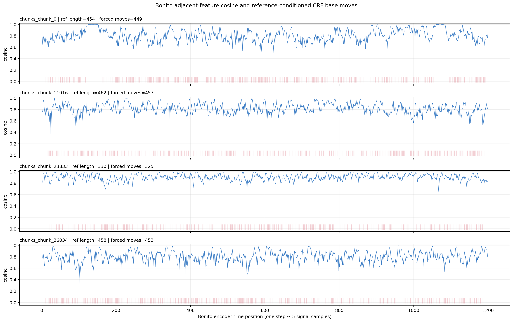
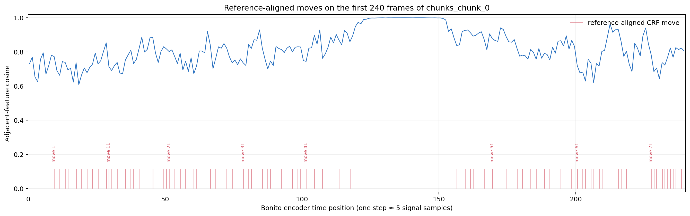
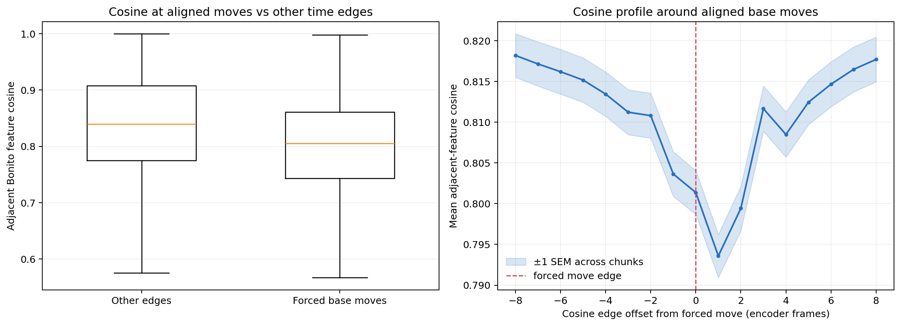

# Bonito 碱基边界与相邻 Cosine 时间轴分析

## 问题与方法

检查 Bonito 相邻时间步的特征方向变化是否与碱基发射边界有关。使用 `dna_basic_0121` 权重，对原先用于跨模型比较的同一批 **128 个等间隔 chunk** 重跑编码器。每个 chunk 输入 6,000 个信号采样点；Bonito 输出 1,200 个、stride 为 5 的时序特征。分析的是最后一层 recurrent feature（`feature_maps[-2]`，即 `LinearCRFEncoder` 投影之前的 768 维向量），并计算每条边上的 `cos(h[t], h[t+1])`。

碱基边界时间点没有独立的逐信号标签，因此这里用已知参考序列约束 Bonito 的 CRF stay/move 格点，求参考序列条件下的 Viterbi 最大分路径。每次从一个参考 k-mer 状态移动到下一个状态视作一次碱基发射；把该移动标记在对应的相邻 feature 边上。强制对齐所用的 stay/move 分数来自同一个 Bonito 模型。

运行环境无法访问 NVIDIA 驱动，本次在指定的 `PoreDLM` conda 环境中使用 CPU 完成。128 个 chunk 均成功对齐。结果中 Bonito 所有相邻边 cosine 的平均值为 **0.822916**，与此前记录的 0.822908 一致。

## 汇总结果

| 指标 | 结果 |
| --- | ---: |
| chunk 数 | 128 |
| 每条序列特征时间步 | 1,200 |
| 参考约束下的边界比例 | 0.3662 |
| 对齐边界处的平均相邻 cosine | **0.7986** |
| 非边界处的平均相邻 cosine | **0.8370** |
| 边界减非边界 cosine | **−0.0383** |
| 每个 chunk 差值的均值 | −0.0339 |
| 每个 chunk 差值的 95% bootstrap 区间 | [−0.0351, −0.0326] |
| 用 `1 − cosine` 判别边界的 ROC-AUC | 0.6183 |
| 用 `1 − cosine` 判别边界的 average precision | 0.4552 |
| average precision 的边界率基线 | 0.3662 |

边界对齐附近的平均 cosine 在指定边界边上为 0.8014，在之后 1 个 encoder frame 的边上降到 0.7936，随后逐步回升。一个 encoder frame 对应约 5 个原始信号采样点。因而曲线低谷靠近边界，但峰值变化的位置略滞后于当前的边界坐标约定。

## 图

全 chunk 时间轴图展示相邻 cosine 曲线，红色短线标出参考序列约束下的 CRF move：



首个 chunk 前 240 个 encoder frame 的放大图：



跨 chunk 的边界/非边界分布和事件对齐平均曲线：



## 解读与限制

结果支持**有一定局部关联，但不是一一对应**：参考对齐 move 周围的 cosine 平均更低；从每条 chunk 的均值看，这一差异在抽样 chunk 中方向一致。AUC 0.618 高于随机水平，但仍不足以单靠 cosine 可靠定位边界。完整曲线里也有许多明显 cosine 低谷并未与 move 重合。

这里的“边界”是 Bonito 自己的 CRF 分数在给定参考序列下选出的最可能路径，不是人工标注的真实物理转移时刻，也不是独立的逐信号真值。由于对齐和特征都来自同一个模型，观察到的关联不能单独证明 Bonito 通过 cosine 或特征方向变化来识别碱基边界。边界与 cosine 边的坐标相差一个 frame 也可能影响事件曲线的最低点位置。

这组分析回答的是“Bonito 内部参考对齐的碱基 move 附近，特征 cosine 是否有系统变化”。如果要判断 cosine 是否能作为可靠的边界指标，下一步应再用准确率较高的独立 basecall/人工标注时间边界验证，并与信号梯度、CRF move 概率等指标对照。

## 产物与复现

- [逐 chunk 指标 CSV](bonito_boundary_cosine_per_chunk.csv)
- [逐时间步特征 cosine、CRF move、对齐路径 NPZ](bonito_boundary_cosine.npz)
- [机器可读汇总 JSON](bonito_boundary_cosine_summary.json)
- [分析与绘图脚本](analyze_bonito_boundary_cosine.py)

复现抽取和绘图：

```bash
MPLCONFIGDIR=/tmp/mpl-codex PYTHONPATH=src \
  /mnt/zzbnew/rnamodel/zhoukexuan/miniconda3/envs/PoreDLM/bin/python \
  src/poredlm/FM_Bonito_Feature_Compare/basecall_boundary_cosine/analyze_bonito_boundary_cosine.py \
  --max-samples 128 --batch-size 4 --device cpu --threads 4
```

只从已有 NPZ 重新生成报告统计和图片：

```bash
MPLCONFIGDIR=/tmp/mpl-codex PYTHONPATH=src \
  /mnt/zzbnew/rnamodel/zhoukexuan/miniconda3/envs/PoreDLM/bin/python \
  src/poredlm/FM_Bonito_Feature_Compare/basecall_boundary_cosine/analyze_bonito_boundary_cosine.py \
  --plot-only
```
