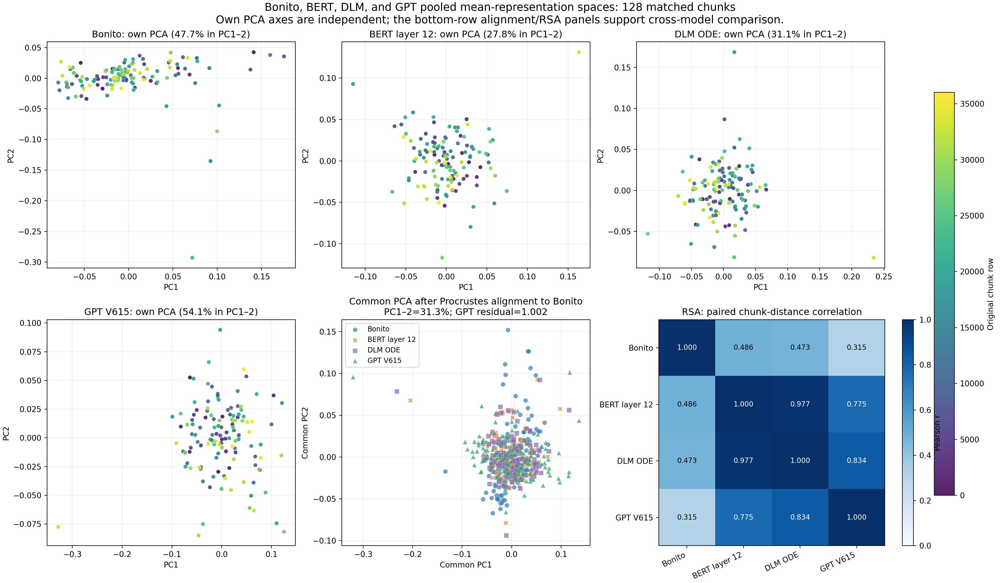
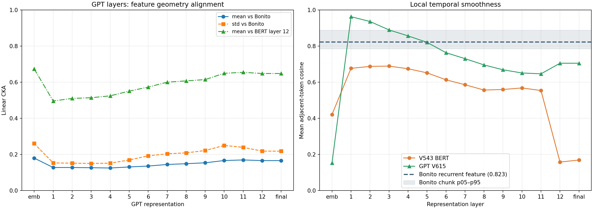

# GPT/OLMo 路线：特征空间与 basecall 训练分析

## 结论

GPT/OLMo 路线值得继续训练。它的最终特征在 pooled 表示空间中**比 BERT 或 DLM 更不像 Bonito**，但这不能解释为特征较差：V613 的 DNA 150k run 到第 25 个完整 epoch 时，训练/验证 CTC loss 为 **0.5302 / 0.5308**，验证 selection score 为 **85.196**。V615 当前到第 8 个完整 epoch，train/val loss 为 **0.6535 / 0.6330**，验证 selection score 为 **76.368**。

特征分析显示 GPT 最终层的相邻 signal-token cosine 为 **0.705**，高于 V543 BERT 实际 basecall 所用第 12 层的 **0.158**；但 Bonito 最后一层 recurrent feature 的相邻位置 cosine 还更高，为 **0.823**（128 个 chunk 的 p05–p95 为 0.785–0.888）。因此，GPT 的局部连续性可能帮助它相对 BERT 更容易优化，但“越平滑越适合 basecall”不成立，不能仅凭 cosine 解释 GPT 相对 Bonito 的表现。它只是一个可检验的线索，仍需要同数据、同划分的 BERT 对照和边界可分性分析。

不要因为 GPT 与 Bonito 的 CKA 较低而退回 BERT/DLM。CKA 衡量的是 chunk 间几何是否相似，不衡量 CTC 可解码性，也不衡量 read-level accuracy。当前数据反而说明“更像 Bonito”不是选基座路线的可靠准则。

## 本次比较的模型和特征

所有空间统计都使用同一批按行严格对齐的 **128 个 DNA signal chunk**。对 Transformer 特征，去掉特殊 token 后，对 1,500 个 signal-token 位置计算时间均值和时间标准差；Bonito 使用最后一层 LSTM、线性 CRF 投影前的 768 维特征。

| 名称 | checkpoint / 特征 | 与实际 basecaller 的关系 |
| --- | --- | --- |
| Bonito | `dna_basic_0121`，最后 LSTM 输出 | 传统端到端基线 |
| BERT layer 12 | V543 BERT 第 12 层输出，final LayerNorm 前 | V543 `hidden_layer=-1` 的实际选择 |
| DLM ODE | V011，1 ODE step、`start_t=0.97`、CFG 0.5 | 现有 DLM `ode_hidden` 分支 |
| GPT V615 | MNAOLMO V615 的 `hidden_states[-1]` | V615 `backbone_type=gpt`、`hidden_layer=-1` 的实际选择 |

V615 是 12 层、hidden size 768 的 `Olmo2ForCausalLM`。输入布局已经核验为 `[BOS, 1500 signal-code tokens, EOS]`，不添加 CLS；`hidden_states[-1]` 与 `last_hidden_state` 数值完全相同，因此它是最后的 RMSNorm 输出。它与此前 BERT 的 `[CLS, BOS, signal codes, EOS]` 输入布局不同，这也是后续严格对照必须固定的条件之一。

## 四模型的 pooled 表示几何

### Linear CKA（时间均值）

| 比较 | CKA |
| --- | ---: |
| Bonito – BERT layer 12 | 0.250 |
| Bonito – DLM ODE | 0.245 |
| **Bonito – GPT V615** | **0.166** |
| BERT layer 12 – DLM ODE | 0.939 |
| BERT layer 12 – GPT V615 | 0.648 |
| DLM ODE – GPT V615 | 0.762 |

距离矩阵的 RSA 也得到相同结论：Bonito–BERT 为 **0.486**，Bonito–DLM 为 **0.473**，Bonito–GPT 为 **0.315**；BERT–DLM 则为 **0.977**。将各模型以正交 Procrustes 变换到 Bonito 空间后的残差，BERT 为 0.919、DLM 为 0.923、GPT 为 1.002（0 表示完全重合）。

这表示 GPT 的样本间组织方式与 Bonito、BERT/DLM 是不同的。它不是负面结果：BERT 与 DLM 的几何最接近，却不能据此推导二者在 CTC 训练速度或最终准确率上优于 GPT。对 basecall 更关键的是时间位置上的碱基边界、可线性解码性和 CTC 对齐，而这些都被时间均值池化丢弃了。



上图中前三个 PCA 面板只能观察各模型内部的样本分布。共同空间中的连线连接同一个 chunk；它直观显示 GPT 与 Bonito 的样本几何没有简单的刚体对应关系。

## 时间轴局部结构：GPT 的主要差异

| 特征层 | mean 相邻位置 cosine |
| --- | ---: |
| BERT V543 第 12 层 | 0.158 |
| Bonito 最后一层 recurrent feature | **0.823**（128 chunk 间 p05–p95：0.785–0.888） |
| GPT embedding 输出 | 0.153 |
| GPT 第 1 层 | 0.963 |
| GPT 第 6 层 | 0.763 |
| GPT 第 10 层 | 0.651 |
| GPT 第 11 层 | 0.646 |
| **GPT 第 12 层 / final RMSNorm** | **0.705** |

GPT 从第一层开始就显著平滑相邻的 signal code，并在深层保持这种局部连续性。BERT V543 则在最后一层发生明显的方向重排：final LayerNorm 前后的相邻 cosine 分别为 0.167 和 0.179。Bonito 的 recurrent feature 具有更高的相邻相似度，说明高 cosine 也可能只是时序编码器的结构特征；它不能单独作为准确率或可解码性的指标。三个模型时间采样的原生步长不完全相同：Bonito 每个位置约对应 5 个原始信号采样点，GPT/BERT 每个 signal token 约对应 4 个采样点，因此读图时应将这些值视为各自时间网格上的局部统计。



GPT 第 10/11 层相对 Bonito 的 CKA 略高于最后层（0.166/0.169 对 0.166），但差距很小，也不构成改用中间层的依据。最终层的相邻 cosine 是深层中最高值，并且它正是当前 V615 训练实际使用的特征。

## 为什么 GPT 路线可能更容易训练

以下是由模型结构、表征统计与日志共同支持的工作假设，尚非因果证明。

1. **因果预训练可能比 BERT 的最终层更保留局部连续性。** OLMo 是 causal LM，每个位置基于当前位置及左侧 signal code 建立表示；BERT/DLM context encoder 使用双向上下文。GPT 最后层相邻 cosine 明显高于 BERT，可能让后续 TCN + CTC head 更容易学习局部对齐。但 Bonito 的相邻 cosine 更高，所以这不构成“越平滑越好”的证据，也不足以单独解释 GPT 与 Bonito 的性能差别。

2. **GPT 的表示并没有为全局 chunk 相似性而压缩。** 它与 Bonito 的 pooled CKA 较低，也比 BERT/DLM 更独立。这可能减少了冻结基座对特定全局模式的强约束，让最后 4 层与 TCN head 在下游数据上有更大的可调整空间。此处的“可能”需要 probe 或消融实验支持，不能把低 CKA 本身当成优势。

3. **位置编码和归一化也可能参与。** V615 使用 RoPE 与 RMSNorm，V543 BERT 使用其 BERT embedding/LayerNorm 路径；这会改变不同长度和不同绝对位置下的特征尺度与几何。它可以是 GPT 验证曲线较稳定的辅助原因，但目前没有单独消融，不能分离于因果预训练目标的影响。

4. **目前两个 GPT run 都没有显示明显的验证退化。** V613 的第 1–25 个完整 epoch 中，val loss 从 1.0684 降到 0.5308，selection score 升至 85.196；训练与验证 loss 的差值当前为 +0.0006。V615 到第 8 个完整 epoch，val loss 为 0.6330，仍在持续改善阶段，不能据此判断其整个训练周期的过拟合程度。

训练 loss 高于 validation loss 的早期现象可由 train mode 的 dropout、数据增强、批统计或优化轨迹引起；它不能单独证明“没有过拟合”。应持续看固定 validation/test split 的 loss、accuracy、coverage、插入/删除率和 read-level accuracy。

## 当前日志证据及其边界

| run | 数据与设置 | 已完成 epoch | 起点 → 当前/最佳验证表现 |
| --- | --- | ---: | --- |
| V613 DNA OLMo | DNA 150k，GPT final hidden，最后 4 层可训练，batch 32，seed 42 | 25 | val loss 1.0684 → **0.5308**；selection 19.323 → **85.196** |
| V615 DNA MNAOLMO | DNA 150k，GPT final hidden，最后 4 层可训练，batch 32，seed 42 | 8 | val loss 0.9151 → **0.6330**；selection 36.361 → **76.368** |

这不能直接和此前 BERT/DLM 的数值比较：其 checkpoint、数据域（先前引用的部分 run 是 RNA）、数据规模、CLS 输入布局和实验时间都不同。用户观察到 GPT 更快、更少过拟合是有价值的现象；现在的日志和特征分析支持继续跟踪该现象，但尚不足以归因到 GPT 架构本身。

## 接下来的训练安排

### 1. 将 GPT V615 作为当前主 run

保持当前设置跑到验证曲线出现明确拐点：`backbone_type=gpt`、`hidden_layer=-1`、最后 4 层可训练、TCN + CTC、150k DNA、`group_by=record`、seed 42、batch 32、head/backbone LR `1e-5`。每个 epoch 记录 train/val loss、accuracy、coverage、非空预测长度，并在固定 test split 上保存 best-validation checkpoint 的 read-level 指标。

### 2. 做一个唯一必要的公平对照

在**同一 DNA 150k 文件、同一按 record 切分、相同 seed、相同 TCN/CTC head、相同有效 batch、相同步数/LR schedule**下，训练 V543 BERT 的最后 4 层。BERT 对照应关闭 CLS，使输入同样为 `[BOS, signal codes, EOS]`。这样才能分别检验：

- GPT 的 loss 是否确实下降更快；
- GPT 的 validation gap 是否更小；
- 差异来自预训练/架构，还是来自数据和输入布局。

### 3. 只在公平基线后做 GPT 层位消融

如最终层与 BERT 对照仍有优势，再比较 GPT 第 12 层（当前 `hidden_layer=-1`）与第 11 层（`hidden_layer=-2`）。选择中间层时，要把可训练块限定在该输出层及其之前；输出之后的层没有损失梯度，不应仍计入“最后 4 层可训练”的参数量。以固定 test split 的 accuracy、coverage 和 read accuracy 选层，不能用 Bonito CKA 选层。

### 4. 用可证伪实验检查“局部平滑性”解释

在同一验证集对三条路线保存 token-level hidden state，训练容量相同的线性 CTC probe，并计算参考碱基边界附近与非边界位置的 cosine/方差。如果 GPT 的 probe 在少量训练步就达到更低 CTC loss，且边界附近的几何变化仍可区分，才支持“平滑且可解码”是收敛更快的原因；若 GPT 在边界处也过度平滑，则应考虑更浅层或加入多层特征融合。

## 复现产物

- [BERT 相邻时间步 cosine 方法初测（保留 Bonito 基线）](../test/相邻时间步Cosine优化方法初测.md)
- [四模型 pooled 空间图](four_model_mean_representation_spaces.png)
- [GPT 分层对齐与局部平滑图](gpt_layer_alignment.png)
- [Bonito 相邻位置 cosine 汇总](bonito_temporal_smoothness_n128.json)
- [Bonito 各 chunk cosine](bonito_temporal_smoothness_n128.csv)
- [四模型统计和训练日志解析](gpt_route_analysis.json)
- [GPT 分层 CKA 表](gpt_layer_alignment.csv)
- [GPT hidden-state 抽取脚本](extract_gpt_hidden_states.py)
- [Bonito temporal cosine 抽取脚本](extract_bonito_temporal_cosine.py)
- [四模型分析脚本](analyze_gpt_route.py)
- [DLM 1-step 训练策略报告](训练策略探索报告_1step_t0.97.md)

重算 Bonito 相邻位置 cosine 并刷新图表：

```bash
PYTHONPATH=src /mnt/zzbnew/rnamodel/zhoukexuan/miniconda3/envs/PoreDLM/bin/python \
  src/poredlm/FM_Bonito_Feature_Compare/explore/extract_bonito_temporal_cosine.py \
  --device cuda:0 --batch-size 4

MPLCONFIGDIR=/tmp/mpl-codex PYTHONPATH=src \
  /mnt/zzbnew/rnamodel/zhoukexuan/miniconda3/envs/PoreDLM/bin/python \
  src/poredlm/FM_Bonito_Feature_Compare/explore/analyze_gpt_route.py
```
