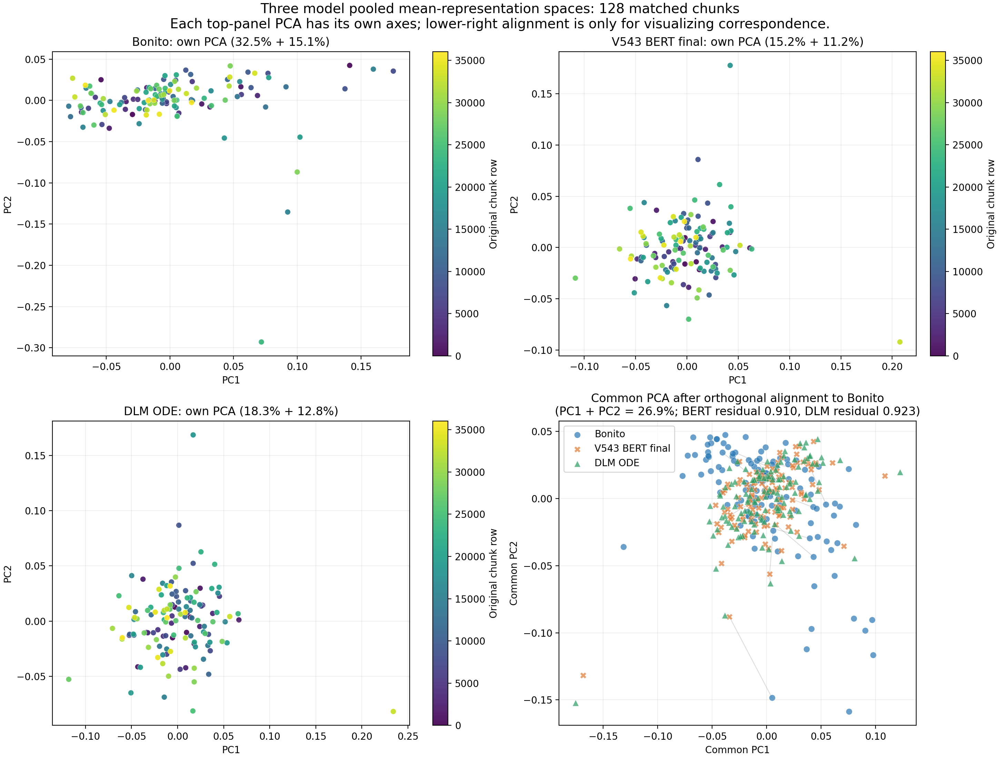
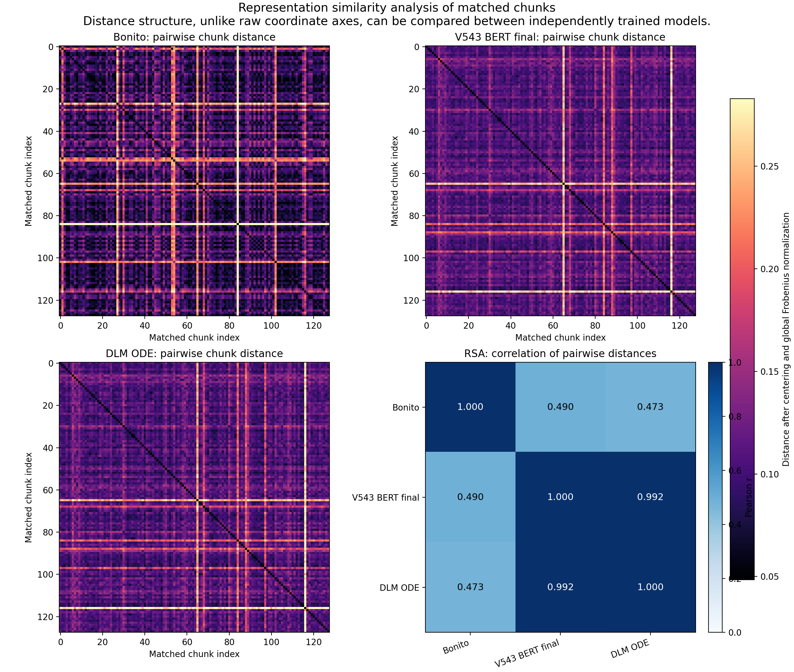

# Basecall 训练策略探索：DLM 1 step、`start_t=0.97`

> **GPT/OLMo 更新**：已将 MNAOLMO V615 纳入与 Bonito、V543 BERT、DLM V011 相同的 128 个配对 chunk 特征分析，并解析 V613/V615 的 DNA basecall 日志。GPT 最终层与 Bonito 的 pooled CKA 较低（0.166），但具有明显更强的 token 时间连续性（相邻 cosine 0.705，BERT layer 12 为 0.158）。这与 GPT 路线更快收敛、验证曲线更稳定的观察相容，但仍需固定同一 DNA 150k split 的 BERT 对照验证。完整讨论、图和可证伪实验见 [GPT/OLMo 路线特征与训练分析](GPT_OLMo路线特征与训练分析.md)。

## 结论

在目前唯一可直接比较的 2 万 chunk 实验中，**DLM `ode_hidden` + 冻结 V543 context encoder + ELF 最后 4 层可训练**仍是已验证的路线：最佳验证选择分数为 **73.754**，高于 V543 context encoder 最后 4 层训练的 **64.886**。优势主要来自更高的 coverage，而不是单独的碱基准确率：DLM 的 accuracy 仅高 0.466 个百分点，但 coverage 高 11.24 个百分点。

GPT/OLMo V615 应同时作为当前主线继续训练。它已有“loss 下降快、V613 在 24 个完整 epoch 内未出现 validation loss 反弹”的观察和特征空间证据，但还没有与 BERT 在同一 DNA 150k split 上的直接对照。当前阶段不应把 DLM 的 2 万 chunk 结果和 GPT 的 150k DNA 日志混合排序；下一步应保持 V615 run，并补一条同设置的 BERT 对照，再决定主模型。

下一次 DLM 训练应保留当前已经验证的 ODE 参数：

```text
feature_source = ode_hidden
unfreeze_context_last_n_layers = 0
unfreeze_elf_last_n_layers = 4
elf_ode_steps = 1
elf_ode_start_t = 0.97
elf_ode_self_cond_cfg_scale = 0.5
```

GPT 分支保持 `backbone_type=gpt`、`hidden_layer=-1`、最后 4 层可训练、TCN + CTC、DNA 150k 和当前 `1e-5` 学习率；其公平对照与层位消融方案见 [GPT/OLMo 路线特征与训练分析](GPT_OLMo路线特征与训练分析.md)。

训练慢的问题有一个可以直接处理的来源：冻结 context encoder 时，使用与当前 checkpoint 严格匹配的 `context_hidden` cache。当前 A800 微基准显示，4 条长度 1,503 的序列上，直接 DLM ODE 特征提取中位数为 **375.5 ms/batch**，从预先给定的 context hidden 只做 ODE 为 **157.9 ms/batch**；特征数值最大绝对差为 **0**。这是 backbone 部分的 **2.38×** 计算加速上限，端到端训练加速会低于此值，因为还包含 cache I/O、TCN、CTC、数据加载与反向传播。

## 实验范围和可比性

| 证据 | 设置 | 结果 |
| --- | --- | --- |
| 三模型特征空间 | 同一批 128 个等间隔 chunk；Bonito、V543 BERT、DLM V011 | DLM 使用 1 step、`t=0.97`、CFG 0.5 |
| DLM vs BERT 训练 | 相同 20,000 chunk、`group_by=record`、seed 42、TCN + CTC、每卡 batch 8、LR 1e-5 | 可直接比较 |
| DLM 300,000 chunk | 300,000 chunk、每卡 batch 32、8 卡 | 数据规模和并行度不同，只作扩展性证据 |
| 推理微基准 | V011 checkpoint、A800、batch 4、序列长 1,503、FP16 autocast | 只衡量 backbone feature path，不代表整轮训练时间 |

下表中的 `selection_score = accuracy × coverage` 来自现有训练日志；它是这两个 run 的统一选择指标，不是标准 Bonito read accuracy。

| 2 万 chunk run | 可训练骨干部分 | 最佳 epoch | accuracy | coverage | selection score | 中位 epoch 时间 |
| --- | --- | ---: | ---: | ---: | ---: | ---: |
| V543 context hidden | context encoder 最后 4 层 | 108 | 74.831% | 86.71% | 64.886 | 201 s |
| DLM ODE hidden | ELF 最后 4 层 | 66 | 75.297% | 97.95% | 73.754 | 245 s |

因此 DLM 的选择分数高 **8.867** 点，训练每 epoch 高约 **22%** 时间。DLM 的非空预测长度为 80.78，context 分支为 71.53，也与 DLM coverage 较高的现象一致。两个 run 仍应在完成后以固定 test split 做一次最终评估；目前日志中的峰值是 validation 峰值。

在 30 万 chunk 的 DLM run 中，最佳验证结果为 epoch 82 的 accuracy **83.060%**、coverage **93.70%**、selection score **77.827**。它表明 DLM 随数据量扩大仍在改善，但不能与上述 2 万 chunk 实验作因果比较。

## 1-step、`t=0.97` 后的特征空间结果

所有 CKA 都在同一 128 个 chunk 上计算。Bonito 用最后一层 LSTM 到线性 CRF 投影前的 768 维输出；BERT/DLM 只用 1,500 个 signal-token 位置，对时间轴计算 mean/std 后比较 chunk 间几何。

| 表示比较 | Linear CKA |
| --- | ---: |
| Bonito mean vs V543 BERT final mean | 0.261 |
| Bonito mean vs DLM ODE mean | 0.245 |
| V543 BERT final mean vs DLM ODE mean | 0.986 |
| Bonito std vs V543 BERT final std | 0.309 |
| Bonito std vs DLM ODE std | 0.300 |

配对 bootstrap 显示，DLM ODE 相比 BERT final 与 Bonito 的 mean CKA 差为 **-0.0156**，95% 区间为 **[-0.0401, -0.0056]**。这说明在 chunk 级 pooled geometry 上，DLM ODE 没有变得更像 Bonito；它也说明 DLM 的训练优势不应理解为“表示更接近 Bonito”。两者的编码目标和时间分辨率不同，CKA 不能代替 CTC probe 或 read-level accuracy。

### BERT 中层是值得验证的备选特征

我重新提取了 V543 embedding、12 个 Transformer 层和 final LayerNorm 输出，且与上述 128 个 chunk 完全按行对齐。BERT 第 6–9 层与 Bonito 的 pooled feature 几何更接近，其中：

| BERT 表示 | Bonito mean CKA | Bonito std CKA |
| --- | ---: | ---: |
| Transformer layer 6 | 0.290 | 0.353 |
| **Transformer layer 7** | **0.296** | 0.371 |
| **Transformer layer 8** | 0.286 | **0.383** |
| Transformer layer 9 | 0.275 | 0.372 |
| Transformer layer 12 | 0.250 | 0.298 |
| Final LayerNorm | 0.261 | 0.309 |

这不是准确率结果，但它给出了两个低成本、可证伪的对照：冻结 V543 后分别用 `hidden_layer=7` 和 `hidden_layer=8` 训练相同的 TCN + CTC head。选择 `hidden_layer=7/8` 需要把 `backbone_type` 设为 `bert`，模型路径指向 V543 的 `base/` 目录；DLM wrapper 只暴露一个序列特征，不能从 DLM wrapper 中选择 BERT 中间层。

## 三模型表征空间可视化

下面两图使用同一批 128 个配对 chunk 的时间均值 pooled feature。由于三个模型独立训练，768 个通道的坐标轴没有直接可比性，因此图中同时展示各自 PCA、经正交 Procrustes 对齐后的样本对应关系，以及不依赖坐标轴方向的样本间距离结构。



上图左上、右上和左下是三个模型各自的 PCA，坐标范围和方向各自独立，只能看每个模型内部的几何分布。右下图把 BERT 与 DLM 旋转到 Bonito 坐标系后再做共同 PCA；浅灰线连接同一个 chunk 在三个模型中的位置。对齐残差以 0 为完全相同：BERT 为 **0.910**、DLM 为 **0.923**，说明两种基座表示都没有与 Bonito 的 chunk 级几何重合。



第二张图的前三个面板是 128 个 matched chunk 的两两距离矩阵。右下角的 RSA 计算两个距离矩阵上三角元素的相关系数：BERT–DLM 为 **0.992**，Bonito–BERT 为 **0.490**，Bonito–DLM 为 **0.473**。因此，当前 1-step DLM 在 chunk 级表示几何上仍紧跟 BERT，并没有向 Bonito 的几何显著靠近。这与 CKA 的结论相同，但不意味着 DLM 对 basecall 无效；现有训练中 DLM 的 coverage 仍然更高。

## 为什么 cache 会明显加速 DLM

当前 DLM 的常规 `forward` 先计算 context encoder，然后总会执行一次 ELF；当请求 `return_ode_hidden=True` 时，又对同一个 context hidden 调用 ODE refinement。相反，basecaller 收到 cache 提供的 `context_hidden` 时，只调用 ODE refinement。微基准的结果如下：

| 路径 | 中位时间 / batch | 说明 |
| --- | ---: | --- |
| 直接 DLM `return_ode_hidden` | 375.5 ms | context encoder + 一次常规 ELF + 一次 ODE ELF |
| context encoder 单独 | 56.2 ms | 冻结时可离线计算 |
| 从 context hidden 只做 ODE | 157.9 ms | cache 命中的计算路径 |

`375.5 / 157.9 = 2.38`，并且两种路径得到的 ODE feature 最大绝对差是 0。这只证明 eval/inference 状态下的 backbone 数值等价；真正训练仍需要保持 cache 对应 checkpoint 固定，且 cache 不能用于 context encoder 可训练的设定。

现有的 43 GB cache 不能直接使用：它的 manifest 记录的是已不可访问的 `/mnt/si002562jbsc/.../step65000-unsharded`，而 cache 校验会同时检查 checkpoint 的绝对路径和由文件大小/mtime 构造的签名。因此必须为当前 V011 checkpoint 重建一份 cache，不能修改 manifest 冒充当前权重。

## DLM `ode_hidden` 推荐训练顺序

### 1. 主实验：缓存化 DLM ODE（优先）

先只改变执行路径，不改变已经有正向证据的优化超参数。这样可以把性能变化归因于缓存，而不是调参。

1. 以当前 V011 checkpoint 和当前 `basecall_20000_chunks` 重建 cache。
2. 复跑 DLM ELF 最后 4 层，保留 1 step、`t=0.97`、CFG 0.5、TCN + CTC、batch 8/GPU、LR 1e-5、200 epoch、warmup ratio 0.1、相同 seed/split。
3. 比较 epoch 时间、最佳 validation score 和固定 test score。缓存不应改变 frozen context feature；若准确率有明显差异，先检查 cache 中 token 序列、CLS/BOS/EOS 和 checkpoint manifest。

生成 cache 的命令：

```bash
ROOT=/mnt/zzbnew/rnamodel/zhoukexuan/PoreDLM
PY=$ROOT/miniconda3/envs/PoreDLM/bin/python
MODEL=/mnt/zzbnew/poregpt/models/HF_RSQ741C12V523_DNADLLM_V011/hf_dlm_elf_mixed_with_cls_token_step65000-unsharded
DATA=$ROOT/src/poredlm/training_public/stage4_basecall_for_RNA/data/RNA_S0_HEK293T_MIX_250NC02106021/basecall_20000_chunks
CACHE=$ROOT/src/poredlm/training_public/stage4_basecall_for_RNA/data/context_hidden_cache/HF_RSQ741C12V523_DNADLLM_V011/basecall_20000_chunks

PYTHONPATH=$ROOT/src CUDA_VISIBLE_DEVICES=1 $PY \
  $ROOT/src/poredlm/training_public/stage4_basecall_for_RNA/data/precompute_context_hidden.py \
  --jsonl_paths $DATA --output_dir $CACHE --model_name_or_path $MODEL \
  --tokenizer_type bwav --tokenizer_token_offset 128 --add_cls_token --cls_token_id 5 \
  --batch_size 8 --num_workers 8 --backbone_chunk_size 1540 --device cuda
```

然后在现有 DLM run 的命令中加入：

```bash
--context_hidden_cache_dir "$CACHE"
```

并保持 `--unfreeze_context_last_n_layers 0`。cache 大小预计接近现有 2 万 chunk cache 的 **43 GB**。

### 2. 对照实验：BERT 第 7、8 层的 frozen-head probe

在上述主实验之外，只做两个小对照，回答“中层 BERT 是否比末层更适合作为 CTC 输入”。所有数据、split、head、decoder 和训练轮数必须完全相同。

```bash
--model_name_or_path /mnt/zzbnew/poregpt/models/HF_RSQ741C12V523_DNABERT_V543/base \
--backbone_type bert --feature_source hidden --freeze_backbone \
--unfreeze_last_n_layers 0 --hidden_layer 7
```

第二个对照只把 `--hidden_layer 7` 改为 `--hidden_layer 8`。在当前实现中，`hidden_states[0]` 是 embedding output，`hidden_states[1..12]` 分别是 Transformer 第 1–12 层，所以这里的 7/8 和上表一一对应。若 layer 7/8 没有超过末层，便可排除“只需换到更像 Bonito 的 BERT 层”这个解释。

### 3. 放大到 30 万 chunk 前的判定

缓存版 DLM 的 2 万 chunk test score 至少不低于未缓存版本，且每 epoch 时间明显下降后，再开始 30 万 chunk 的正式训练。30 万 chunk 训练沿用 DLM ELF 最后 4 层和当前 ODE 参数；不要把 BERT 中层、ODE 参数和 data scale 放在同一次 run 中修改。

每个 run 固定记录以下指标：best/last validation score、最终 test accuracy、coverage、blank fraction、nonzero length、每 epoch wall time、峰值显存。DLM 的当前优势主要体现在 coverage，因此把 raw accuracy 单独作为唯一早停依据会掩盖真实差异。

## 产物和复现

- [分层 CKA 图](bert_layer_strategy.png)
- [各层 CKA 表](bert_layer_strategy.csv)
- [特征与训练日志汇总](strategy_evidence.json)
- [DLM 路径微基准](dlm_ode_path_benchmark.json)
- [微基准脚本](benchmark_dlm_ode_paths.py)
- [三模型空间可视化脚本](visualize_three_model_spaces.py)
- [三模型可视化数值汇总](three_model_visualization_summary.json)
- [BERT 分层抽取结果](bert_layerwise_n128/foundation_layerwise_summary.json)
- [三模型配对特征和 bootstrap](../feature_analysis/paired_features_n128/paired_feature_bootstrap_summary.json)
- [原始三模型特征空间报告](../特征空间分析报告.md)

`analyze_strategy_evidence.py` 可在特征重新提取或训练日志更新后重新生成分层表、图和日志汇总。该脚本验证 BERT 各层与 Bonito/DLM 的 128 个 chunk 行索引一致。
