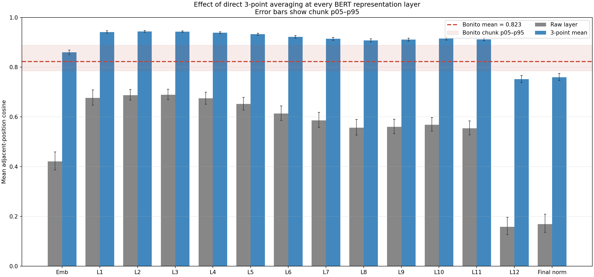
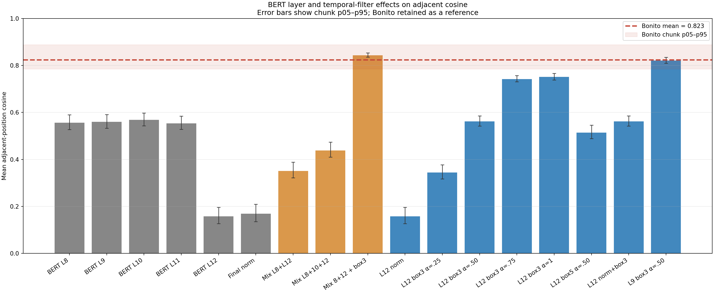

# 相邻时间步 Cosine 优化方法初测

## 范围

本次只对 V543 BERT 的预训练特征做离线变换，观察相邻 signal-token 特征向量的平均 cosine 是否改变；**没有训练 basecaller，也没有根据 cosine 选择最终模型**。所有 BERT 结果使用与此前 Bonito 特征对齐的同一批 128 个 chunk，去除 `[CLS, BOS, EOS]` 后统计 1,500 个位置。

Bonito 原有结果保留为参照，没有重算或覆盖：使用 `dna_basic_0121` 最后一层 recurrent feature（LinearCRF 前），同样对齐 128 个 chunk，每条 6,000 点信号输出 1,200 个特征位置。

## Bonito 参照

| 表征 | 平均相邻位置 cosine | chunk 间 p05–p95 |
| --- | ---: | ---: |
| **Bonito 最后一层 recurrent feature** | **0.8229** | **0.7853–0.8879** |

这是每条 chunk 内相邻特征 cosine 的平均，再对 128 个 chunk 汇总。p05–p95 表示 chunk 间的分布范围，不是均值的置信区间。原始逐 chunk 数据和抽取摘要仍在 [Bonito 汇总](../explore/bonito_temporal_smoothness_n128.json) 与 [Bonito CSV](../explore/bonito_temporal_smoothness_n128.csv)。本报告的 JSON 也保存了完整 Bonito 参照信息。

## BERT 方法结果

### 各层分别做 3 点均值

对每一层特征沿时间维做居中的 3 点均值：`h'[t] = (h[t-1] + h[t] + h[t+1]) / 3`，序列两端用边缘位置复制填充。下表列出每层平滑前后的平均相邻 cosine。`Δ` 是平滑后减平滑前；p05–p95 是 128 个 chunk 的平滑后 cosine 分布范围。

| BERT 表征 | 原始 cosine | 3 点均值后 | Δ | 平滑后 chunk 间 p05–p95 |
| --- | ---: | ---: | ---: | ---: |
| Embedding 输出 | 0.4209 | 0.8597 | +0.4388 | 0.8509–0.8689 |
| 第 1 层 | 0.6765 | 0.9412 | +0.2647 | 0.9366–0.9467 |
| 第 2 层 | 0.6875 | **0.9439** | +0.2564 | 0.9407–0.9474 |
| 第 3 层 | 0.6893 | 0.9428 | +0.2535 | 0.9398–0.9461 |
| 第 4 层 | 0.6746 | 0.9389 | +0.2643 | 0.9355–0.9427 |
| 第 5 层 | 0.6519 | 0.9324 | +0.2805 | 0.9287–0.9367 |
| 第 6 层 | 0.6134 | 0.9220 | +0.3086 | 0.9172–0.9275 |
| 第 7 层 | 0.5860 | 0.9141 | +0.3281 | 0.9087–0.9201 |
| 第 8 层 | 0.5565 | 0.9073 | +0.3509 | 0.9016–0.9141 |
| 第 9 层 | 0.5597 | 0.9105 | +0.3508 | 0.9051–0.9168 |
| 第 10 层 | 0.5682 | 0.9147 | +0.3465 | 0.9095–0.9207 |
| 第 11 层 | 0.5539 | 0.9117 | +0.3578 | 0.9063–0.9179 |
| 第 12 层 | 0.1576 | 0.7514 | +0.5938 | 0.7384–0.7667 |
| Final norm 输出 | 0.1689 | 0.7595 | +0.5906 | 0.7464–0.7751 |



各层的平滑后 cosine 都提高了。最高的是第 2 层（0.9439），第 1–4 层都约为 0.939–0.944；第 8–11 层约为 0.907–0.915；第 12 层和 final norm 分别为 0.7514 和 0.7595。Bonito 参照为 0.8229，所以平滑后的前 11 层高于 Bonito，而第 12 层与 final norm 仍低于 Bonito。变化幅度最大的是第 12 层（+0.5938），其次是 final norm（+0.5906）。

这个排序**不能解读为浅层一定更适合 basecall**：3 点均值会让相邻时间步共享两个输入位置，cosine 自然上升；它可能同时抹平对碱基边界有用的快速变化。该指标只描述方向连续性，不测序列信息保留或识别质量。

| 方法 | 平均相邻位置 cosine | chunk 间 p05–p95 | 与 Bonito 均值差 |
| --- | ---: | ---: | ---: |
| BERT 第 8 层原始输出 | 0.5565 | 0.5274–0.5897 | -0.2664 |
| BERT 第 9 层原始输出 | 0.5597 | 0.5327–0.5905 | -0.2632 |
| BERT 第 12 层原始输出 | 0.1576 | 0.1269–0.1966 | -0.6653 |
| 第 12 层 `last_hidden_state`（final norm） | 0.1689 | 0.1358–0.2093 | -0.6540 |
| 第 8/12 层先逐 token LayerNorm，再等权融合 | 0.3509 | 0.3215–0.3885 | -0.4720 |
| 第 8/10/12 层先逐 token LayerNorm，再等权融合 | 0.4377 | 0.4099–0.4735 | -0.3852 |
| 第 12 层 + 3 点均值，残差比例 0.25 | 0.3446 | 0.3174–0.3776 | -0.4784 |
| 第 12 层 + 3 点均值，残差比例 0.50 | 0.5620 | 0.5424–0.5854 | -0.2609 |
| 第 12 层 + 3 点均值，残差比例 0.75 | 0.7419 | 0.7309–0.7569 | -0.0810 |
| 第 12 层直接替换为 3 点均值 | 0.7514 | 0.7384–0.7667 | -0.0715 |
| **第 9 层 + 3 点均值，残差比例 0.50** | **0.8210** | **0.8093–0.8343** | **-0.0019** |
| 第 8/12 层归一化融合，再做 3 点均值 | **0.8430** | **0.8353–0.8533** | **+0.0201** |

GPT V615 final hidden 的同类均值为 **0.7048**。图中的 Bonito 线及阴影分别是其 128 个 chunk 的均值和 p05–p95 范围。



完整候选方法列表见 [CSV](bert_cosine_method_results.csv)，包含每种方法的均值、chunk 间波动、相对 BERT 第 12 层的变化和相对 Bonito 的差值；机器可读结果见 [JSON](bert_cosine_method_results.json)。

## 初步观察

1. **中间层的局部连续性明显高于 BERT 第 12 层。** 第 8/9 层约 0.56，第 12 层只有 0.158；final norm 将其提高到 0.169，影响很小。这支持把中间层作为 BERT basecall 的候选输入，但 cosine 不等于 basecalling 能力。
2. **普通平滑能提高 cosine，但比例过大才接近 Bonito。** 对第 12 层做 3 点平均时，混合比例 0.50 得到 0.562；增至 0.75 或完全替换后，分别升到 0.742 和 0.751。
3. **第 9 层加中等平滑达到 Bonito 的局部 cosine 水平。** 第 9 层原始值约 0.560，3 点均值按 50% 残差混合后约 0.821；Bonito 为 0.823。
4. **归一化跨层融合单独没有提高 cosine。** 第 8/12 层融合为 0.351，第 8/10/12 层融合为 0.438。对第 8/12 层融合结果再做 3 点平均后达到 0.843，是本轮最高值。

这些结果只回答“数学变换能否提高相邻 cosine”。平滑本身会让相邻输出共享更多内容，因此 cosine 上升在很大程度上是构造出来的；**0.843 高于 Bonito 不表示 basecall 更好**。均值滤波也可能削弱转录/碱基转换附近的急剧变化。接下来真正做 basecall 时，需要把原始 BERT、L9 + 0.50 平滑、L8/L12 融合 + 3 点平滑放入相同训练设置，比较 CTC loss、验证准确率、coverage 和 read-level 指标，并检查边界区域。

## 复现

```bash
MPLCONFIGDIR=/tmp/mpl-codex PYTHONPATH=src \
  /mnt/zzbnew/rnamodel/zhoukexuan/miniconda3/envs/PoreDLM/bin/python \
  src/poredlm/FM_Bonito_Feature_Compare/test/benchmark_bert_cosine_methods.py \
  --device cpu --threads 8
```

仅重绘已有结果图：

```bash
MPLCONFIGDIR=/tmp/mpl-codex PYTHONPATH=src \
  /mnt/zzbnew/rnamodel/zhoukexuan/miniconda3/envs/PoreDLM/bin/python \
  src/poredlm/FM_Bonito_Feature_Compare/test/benchmark_bert_cosine_methods.py \
  --plot-only
```
