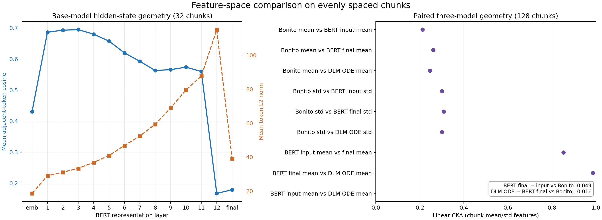

# Bonito、DNA 基座 BERT、DLM 与 GPT/OLMo 特征空间分析

> **训练策略更新（1-step、`ode_start_t=0.97`）**：基于本报告的配对特征、2 万 chunk 的训练日志和 A800 微基准，已完成面向 basecall 训练的后续分析。DLM 仍有直接的 2 万 chunk 对照证据；详见 [训练策略探索报告](explore/训练策略探索报告_1step_t0.97.md)。另已加入 MNAOLMO V615 的 GPT 路线，构成 Bonito、BERT、DLM、GPT 四模型分析；其特征空间、V613/V615 DNA 日志和下一步对照实验见 [GPT/OLMo 路线分析](explore/GPT_OLMo路线特征与训练分析.md)。

## 摘要

在同一批 128 个等间隔 chunk 上，首先比较了传统 Bonito、DNABERT V543 基座 BERT 和以 V543 为上下文编码器的 DLM（step 65000），随后加入 MNAOLMO V615 的 GPT 表示。以实际 basecaller 使用的层为准，Bonito 与 BERT layer 12 的 chunk-mean CKA 为 **0.250**，与 DLM `ode_hidden_state` 为 **0.245**，与 GPT V615 final hidden 为 **0.166**；BERT 与 DLM 为 **0.939**，而 BERT 与 GPT 为 **0.648**。

这批 pooled 表示中，DLM ODE 输出与 V543 BERT layer 12 的跨 chunk 几何仍高度相似；GPT 则形成更独立的样本几何。它说明 ODE 参数会影响 pooled geometry，但这些 CKA 差别不能单独解释 basecalling 性能。不能由此推断 token 级更新很小、DLM 没学到新任务信息，或 GPT 特征质量更差。CKA 也不是碱基可解码性或 basecalling 准确率，不能单独解释训练速度和准确率差异的因果。

## 数据与模型

| 项目 | 检查结果 |
| --- | --- |
| 信号 | `data/signal/eval00001_chunks.npy`，float32，36,035 × 6,000 |
| 参考序列 | `eval00001_references.npy` 为 36,035 × 741；`reference_lengths.npy` 有 36,035 条长度 |
| 基座 token | `data/tokens/eval00001_chunks.jsonl.gz`，36,035 条，每条 1,500 个 signal code；token 行与 signal 行 ID 对齐 |
| 现有 basecall 结果 | `data/basecal_data/eval00001_chunks.jsonl.gz`，和 token 文件 36,035 个 ID 全部对齐；序列长度 269–611，median 453 |
| Bonito 权重 | `/mnt/zzbnew/rnamodel/model/bonito/dna_basic_0121`；`bonito.crf`，5 层 LSTM，特征维度 768，信号 stride 5 |
| DNA 基座 | `/mnt/zzbnew/poregpt/models/HF_RSQ741C12V523_DNABERT_V543`；信号 codec 是 512 通道 CNN、stride 4、FSQ 词码数 2,401；BERT 是 12 层、hidden size 768、最多 1,536 位置 |
| DLM | `/mnt/zzbnew/poregpt/models/HF_RSQ741C12V523_DNADLLM_V011/hf_dlm_elf_mixed_with_cls_token_step65000-unsharded`；Stage 3 ELF mixed，context encoder 指向 V543 base，配置为冻结；输出 768 维 `ode_hidden_state` |
| 运行环境 | 指定 `PoreDLM` conda 环境；PyTorch 2.6.0、Transformers 4.48.3、NumPy 1.26.4；Bonito/BERT 前序分析在 CPU，DLM ODE 抽取在 A800 GPU |

输入 token 是由基座信号 codec 从电信号生成的离散码。DLM checkpoint 自带 tokenizer 将 `<|bwav:n|>` 映射为对应词表 ID（本数据中与 `n+128` 相同）；调用时显式使用 `[CLS=5, BOS=2, 内容, EOS=3]`。BERT 输入 embedding 是 token/position embedding 经过 embedding 归一化后的表示；BERT final hidden 是 12 层 Transformer 的输出。DLM `ode_hidden_state` 从其冻结 V543 context encoder 输出开始，以 1 个 ODE step、`ode_start_t=0.97`、`ode_self_cond_cfg_scale=0.5` 做确定性 refinement。这三种表示都不是原始电流直接输入 Transformer 得到的结果。

## 配对特征结果（128 个 chunk）

样本按数据文件顺序等间隔抽取，ID 从 `chunks_chunk_0` 到 `chunks_chunk_36034`，共 128 条；Bonito 信号行和 BERT/DLM token 行按相同索引配对。Bonito 特征取最后一层 LSTM 输出，即 `LinearCRFEncoder` 投影前的 768 维向量。BERT 与 DLM 表示只取 1,500 个 signal-token 位置，去掉 CLS、BOS、EOS。Bonito stride 5，Transformer 表示每段 1,500 tokens；先对时间维做 mean/std 池化，再比较跨 chunk 的样本 Gram 矩阵。

| 表示比较 | Linear CKA |
| --- | ---: |
| Bonito 时间均值 vs BERT 输入 embedding 时间均值 | 0.212 |
| Bonito 时间均值 vs BERT final hidden 时间均值 | 0.261 |
| Bonito 时间均值 vs DLM `ode_hidden_state` 时间均值 | 0.245 |
| Bonito 时间标准差 vs BERT 输入 embedding 时间标准差 | 0.301 |
| Bonito 时间标准差 vs BERT final hidden 时间标准差 | 0.309 |
| Bonito 时间标准差 vs DLM `ode_hidden_state` 时间标准差 | 0.300 |
| BERT 输入 embedding 时间均值 vs final hidden 时间均值 | 0.852 |
| BERT final hidden 时间均值 vs DLM `ode_hidden_state` 时间均值 | 0.986 |
| BERT 输入 embedding 时间均值 vs DLM `ode_hidden_state` 时间均值 | 0.891 |

相比 BERT final hidden，DLM ODE 表示与 Bonito 的 mean-feature CKA 低 0.016；按 chunk 配对重采样 500 次的 95% percentile 区间为 -0.040–-0.006。BERT final hidden 与 DLM ODE pooled mean 的 CKA 为 0.986，说明两者对 chunk 的整体几何仍高度相似。该值衡量样本间 Gram geometry，不代表两个模型在每个 token 上输出相同向量。区间反映这批等间隔 chunk 的重采样波动，不包含跨测序批次/flowcell 的不确定性。

**解读：** BERT final hidden 与 DLM ODE pooled representation 的 CKA 为 0.986；BERT 输入 embedding 与 DLM ODE 为 0.891。使用 1-step、`start_t=0.97` 后，ODE refinement 相对 2-step、`start_t=0.98` 结果的 chunk-level mean geometry 有可见变化，但仍与 BERT final hidden 高度相似。DLM ODE 与 Bonito 的 CKA 为 0.245，比 BERT final hidden 的 0.261 低 0.016；配对 bootstrap 区间在这批抽样 chunk 上低于零。Bonito 与 BERT/DLM 仍呈现不同的 pooled geometry。不能把较低 CKA 直接解读为表示质量差；它们的目标函数、输入形式和时间步都不同。

按 chunk 池化后的向量 L2 范数均值分别为 Bonito mean **0.745**、BERT input mean **6.563**、BERT final mean **8.121**、DLM ODE mean **8.060**。它们的尺度和归一化方法不同，范数不适合直接评价模型优劣。

## GPT/OLMo V615 扩展

MNAOLMO V615 是 12 层、768 维的 `Olmo2ForCausalLM`。当前 GPT basecaller 的输入是 `[BOS, 1,500 个 signal code, EOS]`，`hidden_layer=-1` 取 `outputs.hidden_states[-1]`；已核验它和 `last_hidden_state` 完全一致。四模型比较中，BERT 也相应使用其实际 `hidden_layer=-1` 对应的第 12 个 Transformer block 输出，而不是仅用于原始表示分析的 final LayerNorm 输出。

GPT 与 Bonito 的 pooled mean CKA 为 **0.166**、距离结构 RSA 为 **0.315**，低于 BERT（0.250 / 0.486）和 DLM（0.245 / 0.473）；BERT–DLM 的 RSA 为 **0.977**，BERT–GPT 为 **0.775**，DLM–GPT 为 **0.834**。GPT 的 chunk 间几何更独立，但这不能等同于 CTC 可解码性较差。

局部统计显示 GPT 最终层的相邻 signal-token cosine 为 **0.705**，BERT 第 12 层为 **0.158**；GPT 第 1 层达到 0.963，深层保持 0.646–0.705。新抽取的 Bonito 最后一层 recurrent feature 则为 **0.823**（128 个 chunk 的 p05–p95：0.785–0.888）。因此 GPT 的局部连续性可能帮助它相对 BERT 更容易优化，但不能据此说 GPT 比 Bonito 更平滑，也不能推导“越平滑越适合 basecall”。V613 到第 25 个完整 epoch 的 val loss 为 0.5308，V615 到第 8 个完整 epoch 为 0.6330，两个 run 当前都仍在改善。完整数值、图和公平对照设计见 [GPT/OLMo 路线特征与训练分析](explore/GPT_OLMo路线特征与训练分析.md)。


## BERT 各层的局部几何（32 个等间隔 chunk）

对 BERT embedding 输出、Transformer 12 层和 final LayerNorm 输出统计 token 向量范数及相邻 token cosine。样本为 32 个等间隔 chunk，1,500 个 signal token 全部参与每段统计。

| 层 | mean token L2 norm | mean 相邻 token cosine |
| --- | ---: | ---: |
| Embedding output | 18.66 | 0.431 |
| Transformer 1 | 29.01 | 0.686 |
| Transformer 3 | 33.37 | 0.695 |
| Transformer 6 | 46.85 | 0.620 |
| Transformer 9 | 68.92 | 0.566 |
| Transformer 11 | 87.71 | 0.560 |
| Transformer 12（final norm 前） | 115.02 | 0.167 |
| Final normalized hidden | 39.04 | 0.179 |

浅层增强了相邻 token 的平滑性，深层则明显重排局部方向；第 12 层输出范数升高，final LayerNorm 后下降。这里的 cosine 是相邻位置的几何统计，不表示这些 token 对应的参考碱基是否正确。



左图使用 32 个 chunk 的逐层结果；右图使用 128 个 chunk，点为 CKA 估计。配对 bootstrap 汇总同时记录 DLM ODE 与 BERT final hidden 的 Bonito-CKA 差值区间。不同估计值来自不同样本规模，不应视为同一条学习曲线。

## 输入 token embedding 的全量统计

从 BERT safetensors 权重直接读取 `token_embedding.weight`，并对 36,035 条记录（共 54,052,500 token）统计：

- 全部 2,401 个 signal code 都出现；频率熵 8.751 bits，对应约 **431 个等频码**的有效 perplexity。它反映码的使用频率集中程度，不是 embedding 向量空间的有效秩。
- 2,401 个词向量行的 L2 norm 均值 1.190，p05/median/p95 为 1.031/1.214/1.293。
- 前 256 个文件顺序 chunk 的抽样中，6.57% 的相邻 token 是同一码。去掉重复码后，相邻 token embedding 平均 cosine 0.127；同段间距 64–512 的远距离对照为 0.056。

这部分是 Transformer 前的静态 lookup 表统计，和上面的上下文化 hidden state 分层分析不是同一个对象。

## 对训练现象的含义与局限

当前观测支持“基座/DLM 表示和 Bonito encoder feature 的 chunk 级组织方式不同”，但**不能**证明这种差异造成训练慢或准确率较低。DLM 的 ODE 表示与其冻结的 V543 上下文编码器关系很近；本次只通过 pooled CKA 看到 chunk-level geometry 几乎不变。CKA 使用时间池化，会丢失碱基边界和局部动态；Bonito stride 5 与 BERT/DLM 1,500 token 长度也未做时序/参考坐标对齐。样本只来自一个数据文件，且是等间隔 chunk，不代表独立 reads 或不同实验批次。

作为局部补充，已在 [Bonito 碱基边界与相邻 Cosine 时间轴分析](basecall_boundary_cosine/Bonito碱基边界与相邻Cosine时间轴分析.md) 中对 128 个 chunk 做了参考序列约束的 CRF 强制对齐。Bonito 对齐 move 处的相邻 cosine 均值比其他位置低约 0.038，`1−cosine` 的边界判别 AUC 为 0.618，显示弱到中等的局部关联。这里的边界位置由同一个 Bonito 模型在参考序列条件下推断，并非独立标注；因此结果不能证明 cosine 本身是 Bonito 的边界检测机制。

进一步判断训练表现需要把 Bonito、BERT 和 DLM 的 feature 按参考坐标或 CTC/CRF 对齐，再比较：

1. 各层 feature 的 base/k-mer 线性 probe 或 CTC probe，使用按 read 分组的 train/validation 切分；
2. 时间对齐后的 tokenwise CKA、局部邻域平滑度和边界可分性；
3. 训练时的吞吐、显存和收敛曲线，与同样本的 feature probe 结果联合分析。

Bonito config 没有显式 scaling 配置；本次将 `data/signal` 中已保存的 float32 信号直接传给 Bonito。所选 128 个 chunk 的总均值为 0.00055、标准差为 0.879，处于近零均值、单位尺度范围。若这些 chunk 的上游归一化流程与 Bonito 训练数据不一致，可能影响比较；应核对生成 `data/signal` 时使用的 reader/scaling 处理。

## 可复现产物

- [分层特征分析图](feature_analysis/feature_space_summary.png)
- [配对 CKA 及 bootstrap 汇总](feature_analysis/paired_features_n128/paired_feature_bootstrap_summary.json)
- [配对特征数据（128 chunks）](feature_analysis/paired_features_n128/paired_pooled_features.npz)
- [DLM ODE 抽取配置与检查记录](feature_analysis/paired_features_n128/dlm_ode_feature_summary.json)
- [基座分层汇总（32 chunks）](feature_analysis/foundation_hidden_states/foundation_layerwise_summary.json)
- [全量静态 token embedding 汇总](feature_analysis/token_embedding_analysis.json)
- [各 signal code 频数与词向量范数](feature_analysis/token_embedding_code_frequencies.csv)
- [分层 hidden-state 抽取脚本](extract_foundation_hidden_states.py)
- [Bonito 相邻时间步 cosine 抽取脚本](explore/extract_bonito_temporal_cosine.py)
- [Bonito 128 chunk 局部连续性汇总](explore/bonito_temporal_smoothness_n128.json)
- [Bonito 各 chunk 局部连续性数据](explore/bonito_temporal_smoothness_n128.csv)
- [配对 Bonito / 基座特征抽取脚本](extract_paired_features.py)
- [DLM `ode_hidden_state` 抽取脚本](extract_dlm_ode_features.py)
- [CKA bootstrap 与图表脚本](summarize_feature_analysis.py)

复现配对抽取和摘要：

```bash
python extract_paired_features.py \
  --signal-npy data/signal/eval00001_chunks.npy \
  --tokens-jsonl-gz data/tokens/eval00001_chunks.jsonl.gz \
  --bonito-model-dir /mnt/zzbnew/rnamodel/model/bonito/dna_basic_0121 \
  --max-samples 128 --batch-size 1 --threads 4 --device cpu \
  --output-dir feature_analysis/paired_features_n128

python summarize_feature_analysis.py \
  --paired-dir feature_analysis/paired_features_n128 --bootstrap 500
```

DLM ODE 抽取使用 1 step、`ode_start_t=0.97`、`ode_self_cond_cfg_scale=0.5`，并在 A800 上执行：

```bash
python extract_dlm_ode_features.py \
  --dlm-model-dir /mnt/zzbnew/poregpt/models/HF_RSQ741C12V523_DNADLLM_V011/hf_dlm_elf_mixed_with_cls_token_step65000-unsharded \
  --max-samples 128 --batch-size 4 --threads 4 --device cuda \
  --ode-steps 1 --ode-start-t 0.97 --ode-self-cond-cfg-scale 0.5 \
  --output-dir feature_analysis/paired_features_n128
```
